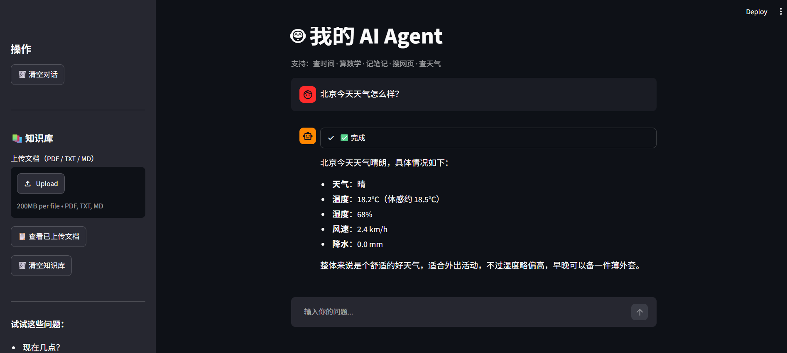
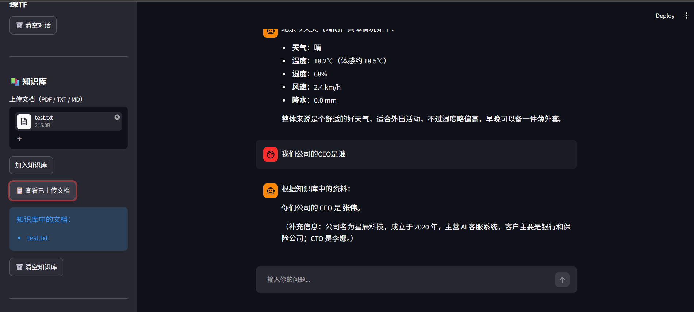
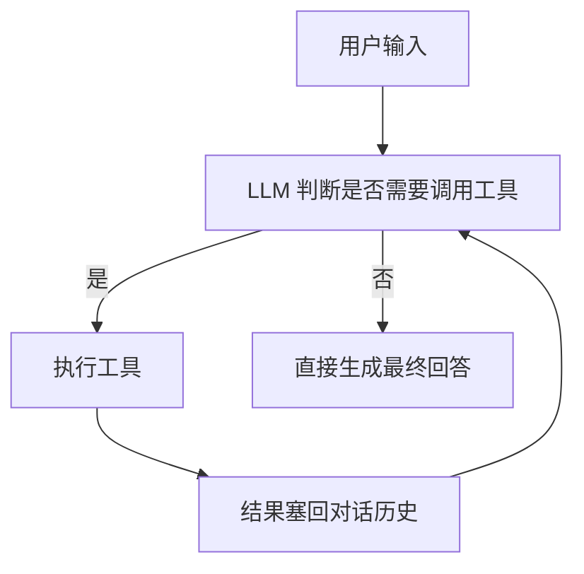
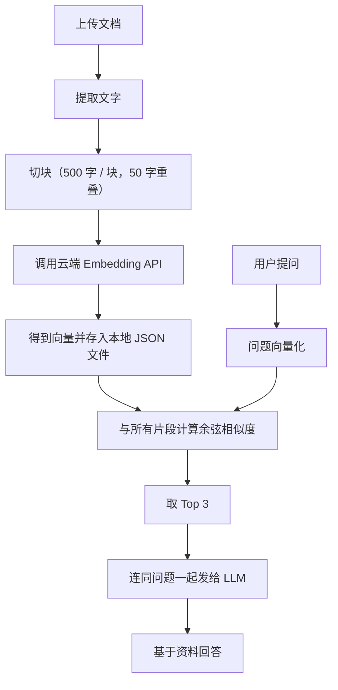

# 🤖 AI Agent 智能助手

一个从零构建的、功能完整的 AI Agent 项目。基于 Function Calling 实现 ReAct 式 Agent 循环，支持 8 类工具调用，并内置 RAG 知识库问答能力。


## 🌐 在线体验

👉 [https://ai-agent-demo-fxy.streamlit.app](https://ai-agent-demo-fxy.streamlit.app)

---

## ✨ 功能特性

### 8 类工具，覆盖日常场景

| 工具 | 说明 |
|---|---|
| 🕐 时间查询 | 返回北京时间（已做时区处理） |
| 🧮 数学计算 | 安全解析数学表达式，不使用 `eval` |
| 📝 笔记保存 | 记录待办或想法到本地文件 |
| 🔍 网页搜索 | 基于百度搜索，国内直连、无需代理 |
| 🌤️ 天气查询 | 基于 Open-Meteo，无需 API Key |
| 🌐 网页正文 | 抓取 URL 正文内容并让 AI 总结 |
| 💱 汇率查询 | 实时汇率换算，支持主流货币 |
| 📚 知识库检索 | RAG 架构，基于上传的文档回答 |

### 核心亮点

- **ReAct 式 Agent 循环**：LLM 自主判断是否需要调用工具，多轮调用直到生成最终回答。
- **RAG 知识库**：上传 PDF / TXT / MD，切块后用云端 Embedding 转向量，余弦相似度检索。
- **工具调用可视化**：界面上实时显示“正在搜索…”、“正在查询天气…”等状态。
- **对话历史持久化**：SQLite 存储，刷新页面不丢失。
- **跨时区正确处理**：显式指定北京时间，不受服务器时区影响。

---

## 🖼️ 效果演示



> **你：** 北京今天天气怎么样？  
> 🤔 思考中...  
> 🌤️ 正在查询天气：北京  
> ✅ 完成  
>
> 北京（中国）当前天气：  
> 天气：晴  
> 温度：18.5°C  
> 体感：17.2°C  
> 湿度：45%  
> 风速：12.3 km/h



> **你：** 请检索知识库，我们公司的 CEO 是谁？  
> 📚 正在检索知识库  
> ✅ 完成  
>
> 根据知识库检索结果：你们公司的 CEO 是张伟。  
> （来源：test.txt）

---

## 🛠️ 技术栈

| 层 | 技术 |
|---|---|
| LLM | DeepSeek（OpenAI SDK 兼容） |
| Agent 架构 | Function Calling + ReAct 循环 |
| Embedding | 硅基流动 `BAAI/bge-m3` |
| RAG 检索 | Numpy 余弦相似度 |
| Web 界面 | Streamlit |
| 对话持久化 | SQLite |
| 部署 | Streamlit Cloud |

---

## 📁 项目结构

```text
ai-agent-demo/
├── agent.py              # Agent 核心循环（ReAct）
├── app.py                # Streamlit Web 界面
├── tools.py              # 8 个工具的定义与注册
├── rag.py                # RAG 知识库逻辑
├── database.py           # SQLite 对话历史持久化
├── requirements.txt
├── .env.example          # 环境变量模板
└── README.md
```

---

## 🚀 快速开始

### 1. 克隆项目

```bash
git clone https://github.com/yourname/ai-agent-demo.git
cd ai-agent-demo
```

### 2. 创建虚拟环境

```bash
python -m venv venv
```

Windows：

```bash
venv\Scripts\activate
```

Mac / Linux：

```bash
source venv/bin/activate
```

### 3. 安装依赖

```bash
pip install -r requirements.txt
```

### 4. 配置环境变量

复制 `.env.example` 为 `.env`，填入你的 Key：

```env
# LLM（推荐 DeepSeek，国内可用）
API_KEY=sk-你的DeepSeekKey
BASE_URL=https://api.deepseek.com
MODEL=deepseek-chat

# Embedding（RAG 用，硅基流动注册送 2000 万 tokens）
SILICONFLOW_API_KEY=sk-你的硅基流动Key
```

- DeepSeek API Key：[platform.deepseek.com](https://platform.deepseek.com)
- 硅基流动 API Key：[siliconflow.cn](https://siliconflow.cn)

### 5. 运行

命令行版本：

```bash
python agent.py
```

Web 界面版本：

```bash
streamlit run app.py
```

浏览器打开 [http://localhost:8501](http://localhost:8501)。

---

## 💡 使用示例

启动后可以试试：

- 现在几点？
- 计算 `(12+8)*3/5`
- 北京今天天气怎么样？
- 搜一下今天的 AI 新闻
- 100 美元等于多少人民币？
- 帮我读一下 [https://example.com](https://example.com)
- 帮我记一下：明天买牛奶
- 侧边栏上传文档后问：我们公司的 CEO 是谁？

---

## 🧠 Agent 工作原理



核心逻辑在 `agent.py` 的 `run_agent` 函数，是一个 `while True` 循环，直到 LLM 不再返回 `tool_calls` 为止。

---

## 📚 RAG 工作流程



---

## ⚠️ 已知限制

- **云端知识库不持久**：Streamlit Cloud 容器重启（重新部署、休眠唤醒）后，`knowledge_base.json` 和 `chat_history.db` 会清空。长期使用建议接入 Supabase 等云存储。
- **百度搜索稳定性**：依赖 `baidusearch` 库解析百度结果，若百度改版可能失效。
- **PDF 扫描件**：无文字层的扫描 PDF 无法提取文字，需 OCR。

---

## 🗺️ Roadmap

- [ ] 接入 Supabase，实现云端知识库持久化
- [ ] 多会话管理（左侧历史会话列表）
- [ ] 支持 Markdown 渲染与代码高亮
- [ ] 支持更多文档格式（DOCX、Excel、PPT）
- [ ] 换用本地模型（Ollama + Qwen）实现完全离线

---

## 📄 License

MIT

---

## 🙏 致谢

- [DeepSeek](https://platform.deepseek.com) — LLM 能力
- [硅基流动](https://siliconflow.cn) — Embedding API
- [Open-Meteo](https://open-meteo.com) — 免费天气数据
- [Streamlit](https://streamlit.io) — Web 框架

---

如果这个项目对你有帮助，欢迎 Star ⭐